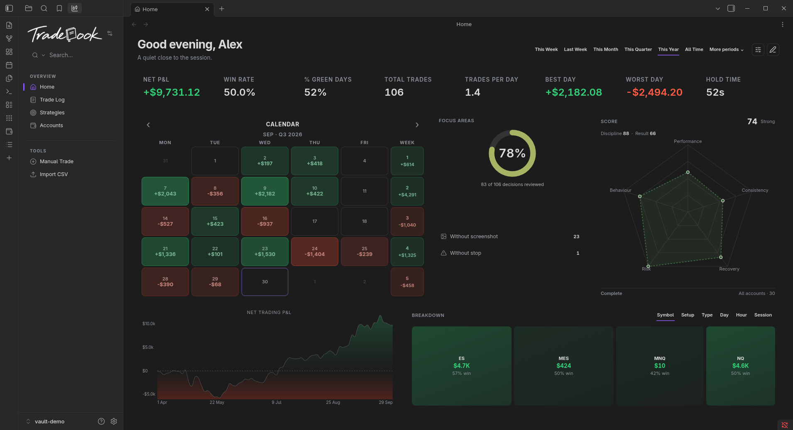

  <picture>
    <source media="(prefers-color-scheme: dark)" srcset="https://raw.githubusercontent.com/yamihugo/Tradebook/refs/heads/main/assets/readme/logo-white.png">
    
  </picture>
  <h3>A local, private futures journal for Obsidian.</h3>
  

    <a href="#key-features">Key features</a> &nbsp;·&nbsp;
    <a href="#installation">Installation</a> &nbsp;·&nbsp;
    <a href="#getting-started">Getting started</a> &nbsp;·&nbsp;
    <a href="#roadmap">Roadmap</a>
  

  

**Tradebook** is a local-first futures trading journal for Obsidian. It keeps a record of
your trading as Markdown notes in your vault and helps you review the results.

## Key features

- **A local Markdown journal.** Trades and notes are Markdown files in your vault.
  Screenshots are image attachments.
- **Trade Log and review.** Browse and filter trades, search strategies and reflection
  notes, and see whether the six review signals are complete or a trade was explicitly
  marked.
- **Print Queue.** Capture chart screenshots in groups during a session, then attach a
  group to its trade in Trade Detail.
- **Accounts, evals, funded accounts and payouts.** Track evaluation, funded and
  demo accounts with their rules and limits, and record deposits, payouts and
  corrections separately from trading results.
- **Tradovate imports.** Import Orders, Fills and Cash History, preview the
  result, and reimport without creating duplicates.
- **TradeSea imports.** Import a TradeSea orders export, preview the result, and
  reimport without creating duplicates. P&L is before costs.
- **Home overview.** Period filters, Net Trading P&L, an equity curve based on
  your recorded trading data, a performance calendar, breakdowns by setup, session,
  symbol and day, and a Trading Score.
- **Copy Trading.** Define a leader and its copiers with a ratio and start date,
  and match a follower's real fills against the generated records.

## Installation

Tradebook requires **Obsidian 1.7.2 or newer**. If you do not use Obsidian yet, download it
from [obsidian.md](https://obsidian.md) and open a vault — a new, empty vault is fine. If you
already use Obsidian, continue below.

1. Open Obsidian Settings.
2. Go to Community plugins and select Browse.
3. Search for Tradebook.
4. Select Install, then Enable.

Tradebook's menu opens in Obsidian's left sidebar. Use it to move between **Home**,
**Accounts** and **Trade Log**, or to add and import trades.
Open Print Queue from its ribbon shortcut; it appears in Obsidian's right sidebar.

To update, use *Settings → Community plugins → Check for updates* in Obsidian.
If you installed through BRAT, use BRAT to update. For a manual installation, replace
only `main.js`, `manifest.json` and `styles.css`; keep your existing `data.json`.

## Getting started

1. **Add an account.** Choose **Accounts** in the Tradebook sidebar, then **Add account**.
   Select its type, firm, rules and limits.
2. **Bring in your trades.** Choose **Import CSV** for Tradovate Orders/Fills and, when
   available, Cash History. Check the preview before importing. You can also choose
   **Manual Trade** to add a trade yourself. Record each actual partial exit with its
   quantity, price and time. Summaries are calculated from those fills, not edited
   independently. TP, SL and BE labels are calculated automatically.
   For TradeSea, use one checked orders export per batch; its P&L is before costs.
3. **Capture chart context (optional).** Use **Print Queue** to collect screenshots in a
   group. After the trade record exists, open it in **Trade Detail** and attach the group.
4. **Review a trade.** Select one strategy and a rating from 1–5, choose psychology
   and execution tags or acknowledge none, and write both reflection prompts. It becomes
   **Reviewed** automatically unless explicitly reopened. Existing multiple strategy
   assignments stay visible until you choose one. Execution labels are automatic:
   profitable closes are TP, losing closes are SL and flat closes are BE, before costs.
   Recorded trade costs stay separate from any unknown per-fill split. **Correct fees**
   on an account reconciles its balance; it does not rewrite broker-recorded trade costs.
5. **Visit Home.** Review your results and explore the trades behind them.

## Your data and backups

Your trade notes and image attachments are stored in your vault. Trade notes remain
there when you disable or uninstall the plugin. Obsidian handles Community plugin
update checks separately.

Settings and account configuration are stored in the plugin's `data.json`. Disabling
the plugin preserves that file; uninstalling removes the plugin folder, including it.

Before uninstalling, export a settings backup from *Settings → Tradebook → Advanced → Export*.
Use **Import backup** in the same section to restore it. Keep a separate backup of your
vault for the trade notes and attachments.

## Known limitations

Generated copy trades are models, and reported costs cannot always be assigned to an
individual trade with certainty. TradeSea P&L is before costs: the importer does not apply
the file's per-order commission. Other export formats are not currently supported.
Tradebook can run on mobile, but phone and tablet layouts still need work.
[Known limitations](KNOWN-LIMITATIONS.md) explains how these cases, missing data and
import formats are handled.

If Tradebook is missing from the list, check that Restricted mode is off and search for
it again. If it does not load, check that Obsidian is 1.7.2 or newer, Restricted mode is
off and Tradebook is enabled. If the sidebar is hidden, expand Obsidian's left sidebar
and select the Tradebook tab.

If something is not working as expected, [open an issue](https://github.com/yamihugo/Tradebook/issues)
with what happened and the steps to reproduce it. Please remove personal and account
information from screenshots or sample files.

## Roadmap

Current priorities are everyday reliability, navigation, light mode, help and polish, with
phone and tablet layouts still to improve. Later work covers strategy review and the
analysis built around it. There are no dates and the order is not fixed.

See [ROADMAP.md](ROADMAP.md) for the full list, and [CHANGELOG.md](CHANGELOG.md) for what
has already shipped.

## License

  

MIT — see [LICENSE](LICENSE).

Prop-firm and broker names and logos belong to their owners and are used to identify
accounts. Their inclusion does not imply affiliation or endorsement.
